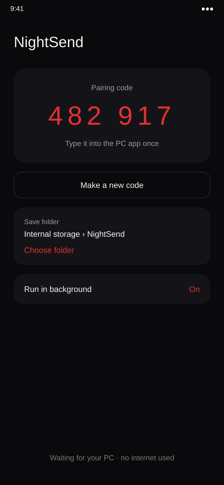
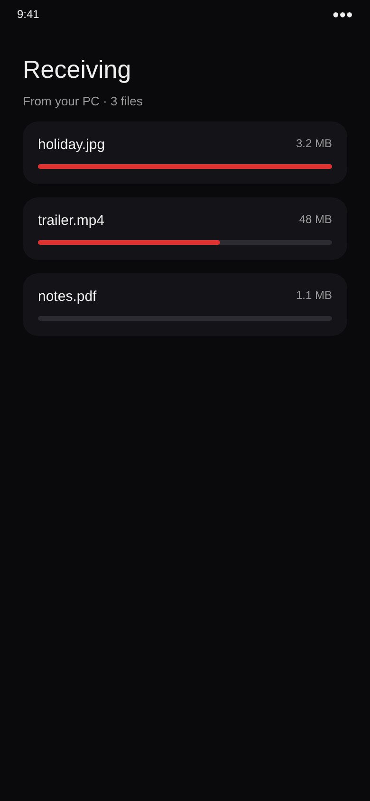
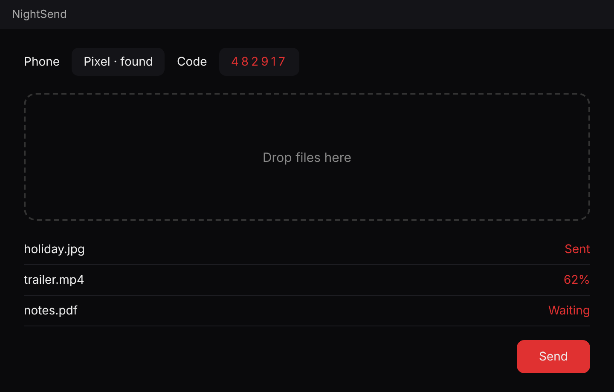

# NightSend

Private direct file transfer between a Windows PC and an Android phone, both ways.
The PC finds the phone by itself; you pair once by scanning a QR code. No internet, no cloud, no relay.

- `app/` - Android receiver app (APK built automatically by GitHub Actions, see Releases)
- PC sender: `NightSend.exe` (see Releases), or `pc/NightSend.bat` + `pc/NightSend.ps1` (Windows 10/11, nothing to install)

## Screens

These are design previews. The finished app follows this look.

<table>
  <tr>
    <td></td>
    <td></td>
    <td></td>
  </tr>
</table>

## Pairing and encryption (v3)
Pair once per PC with a QR code:
1. On the PC press **Pair with QR**. A one-time QR code appears (a random 128-bit secret made on the PC).
2. On the phone tap **Scan the PC's QR code** and point the camera at the PC screen. (No camera? Choose **Type the code instead** and type the code shown under the picture.)
3. On the PC press **Find phone**.

- The secret is never sent. PC and phone prove they know it, and swap fresh one-time keys (ECDH P-256) for every connection. It is 128 bits, so it cannot be guessed, even by someone on the same Wi-Fi.
- It works once and only for 2 minutes after the phone scans it. 3 wrong tries close the pairing window. Without a scan the phone does not accept any pairing at all.
- Everything after that (commands, file names, file data) is encrypted and signed (AES-256 + HMAC-SHA256). Anyone watching the Wi-Fi sees nothing readable and cannot change or replay anything.
- After pairing the PC keeps a secret key (locked to your Windows user). From then on the PC reconnects by itself, with no QR code.
- Tap "forget all paired PCs" on the phone to lock out every PC.
- **Strict mode** (tick it on the phone and on the PC): nothing is remembered. Every session needs a fresh QR scan, and a dropped connection means scanning again. Most private; least convenient.
- The phone scans the picture with its camera and throws the frames away. Nothing is saved or sent anywhere.
- Best links: a USB cable (USB tethering) or the phone's own hotspot / Wi-Fi Direct. Your home Wi-Fi works too.
- The phone app and the PC app must both be v3. The build publishes them together.

## Send from the phone to the PC
1. On the phone, under **SEND TO PC**, tap **Choose folder to send** and pick a folder (not a whole storage).
2. On the PC, pick **Save on this PC** (section 3) and press **RECEIVE**.

- The PC can only take files from the one folder the phone chose, and only while it is paired. Tap **stop sharing** on the phone to close it.
- Same encryption, same pairing, same Wi-Fi as sending. Folders keep their structure.
- Files already on the PC with the same size are skipped, so pressing RECEIVE again continues where it stopped. A file is only kept once its size matches the phone's.
- Both apps need this version. An older phone app answers "too old"; install the newest NightSend.apk.

## Archive after sending
Tick **After a clean send, archive the folder to** in the PC app and pick an archive folder. When every file has been sent and size-checked by the phone, the sent folder is moved into the archive folder. It is a plain move on the same drive: nothing is copied, compressed or deleted. If any file failed, or the archive folder is on another drive, nothing is moved.

## Background
- Phone: NightSend receives in the background (foreground service, notification). Pick the save folder with **Choose folder**.
- PC: minimize or press X while sending and it keeps going from the system tray. Right-click the tray icon > Exit to quit.
